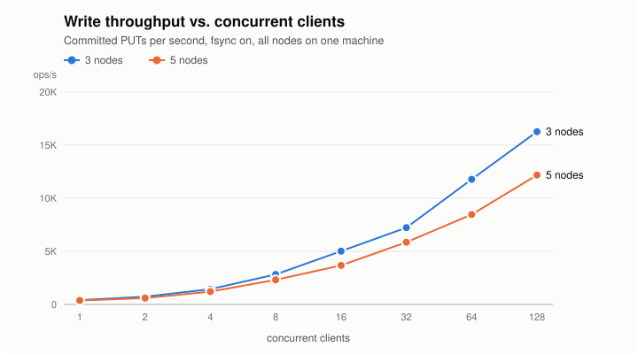
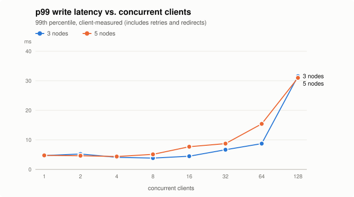

# RaftKV

[](https://github.com/Ayush0612005/raftkv/actions/workflows/ci.yml)

A replicated, fault-tolerant key-value store built from scratch on the
[Raft consensus algorithm](https://raft.github.io/raft.pdf), in plain Java 25 with no framework. RaftKV covers
the same ground as the internals of etcd, Kafka's KRaft and replicated databases: leader election, log
replication, a write-ahead log, crash recovery, exactly-once client semantics and log compaction. It is tested
against injected faults and checked for linearizability.

Status: **all six phases complete**. See [Results](#results), [Quick start](#quick-start) and the per-phase
reports in [`docs/`](docs).

## Highlights

- **Raft from the paper**: elections, log replication with accelerated backtracking, the §5.4.2 commit rule
  with a no-op on election, persistence, snapshots and InstallSnapshot. Single lock per node; RPCs on
  **virtual threads**.
- **Own storage engine**: an append-only WAL with CRC32C records, group-commit `fsync` and torn-write recovery,
  plus atomic snapshot files. A crash at any point recovers (unit-tested by cutting files mid-write).
- **Exactly-once, linearizable KV**: GET/PUT/DELETE all go through the log; a per-client dedup table, carried in
  snapshots, makes retries safe.
- **Tested like a distributed system**:
  - an in-process network that drops, delays, reorders and partitions messages, and crashes nodes, running
    MIT 6.5840-style tests (Figure 8, unreliable churn);
  - a **WGL linearizability checker** over concurrent client histories;
  - a chaos script that `kill -9`s and partitions a real Docker cluster in CI;
  - **mutation checks**: the code was deliberately broken in each phase, and the tests catch it.

## Results

Measured on one laptop: AMD Ryzen 5 7235HS (8 logical CPUs), 12 GB RAM, Micron NVMe SSD, Windows 11, Java 25.
**All nodes and the load generator run on the same machine** and share its CPUs and disk, so the numbers show how RaftKV scales and where
it is bound, not what separate servers would reach. Writes only (`PUT`, 100-byte values, 10,000 keys), closed-loop
clients using the real client library over gRPC, **fsync on**. Each point: 3 s warm-up + 10 s measured after a
15 s per-cluster JIT warm-up. Raw data: [`docs/bench/results.csv`](docs/bench/results.csv),
[`environment.txt`](docs/bench/environment.txt).





| Clients | 3 nodes: ops/s | p50 ms | p99 ms | 5 nodes: ops/s | p50 ms | p99 ms |
| ---: | ---: | ---: | ---: | ---: | ---: | ---: |
| 1 | 403 | 2.36 | 4.68 | 375 | 2.55 | 4.75 |
| 4 | 1,444 | 2.65 | 4.10 | 1,211 | 3.24 | 4.37 |
| 16 | 5,016 | 3.09 | 4.46 | 3,676 | 4.13 | 7.69 |
| 64 | 11,787 | 5.20 | 8.73 | 8,470 | 7.14 | 15.42 |
| 128 | 16,266 | 7.37 | 31.54 | 12,181 | 9.70 | 30.98 |

All points (1–128 clients): [`docs/bench/results.md`](docs/bench/results.md). No operation failed in any run.

**What the numbers say**

- **One client, ~2.4 ms per write**: a write is committed only after the leader *and* a follower have
  `fsync`ed it. That is two sequential disk flushes (~0.37 ms each on this SSD, see below) plus two gRPC round
  trips and the applier.
- **Throughput grows ~40x from 1 to 128 clients while median latency only triples.** This is **group commit**:
  writes that arrive while a round is in flight share the next AppendEntries and the next `fsync`. The WAL
  benchmark shows the same effect in isolation: 32 entries per `fsync` give 32x the entries per second.
- **5 nodes are 7–28% slower than 3** (about 25% under heavy load): each write needs 3 acknowledgements instead of 2, and the leader
  replicates to 4 followers instead of 2, on the same 8 CPUs. In return, the cluster survives 2 failures
  instead of 1.
- **p99 jumps at 128 clients** (≈31 ms for both sizes): CPU saturation on the shared laptop, with 4–6 JVMs and
  128 client threads on 8 logical CPUs. It is not a protocol limit.

**Micro-benchmarks (JMH)**, [`docs/bench/jmh.txt`](docs/bench/jmh.txt):

| Benchmark | Result |
| --- | ---: |
| WAL append + `fsync`, 1 entry per sync | 2,701 entries/s (≈ 0.37 ms per fsync) |
| WAL append + `fsync`, 32 entries per sync (group commit) | 85,818 entries/s |
| WAL append, no fsync, 1 / 32 per sync | 388K / 3.75M entries/s |
| KV state machine apply (PUT / GET, incl. decode + dedup) | 1.9M / 2.0M ops/s |
| Snapshot serialize / restore, 100,000 keys | 63 ms / 33 ms |

The state machine is ~100x faster than the WAL: **durability and consensus are the cost, not the map.**

## Testing

| Layer | What runs | Where |
| --- | --- | --- |
| Unit | log, WAL recovery (torn writes, corrupt records, crash between snapshot steps), KV + dedup, the checker itself | CI job `unit` |
| Fault injection | 5 suites on a simulated network that drops, delays, reorders, partitions and crashes: election, replication, persistence (Figure 8), snapshots, linearizability | CI job `fault injection`, **run twice in parallel** on every push |
| Real gRPC | 3 nodes in one JVM over localhost: leader crash/restart, InstallSnapshot, CLI | CI job `unit` |
| Real cluster | [`scripts/chaos.sh`](scripts/chaos.sh): 3 containers; `kill -9` the leader, restart it, partition a follower, partition the leader; checks no committed write is lost and every node catches up | CI job `docker cluster chaos test` |

79 JUnit tests plus the chaos script. Each phase report lists its **mutation checks**: a safety rule removed on
purpose (e.g. fsync before acknowledging, the dedup table in snapshots) and the tests that caught it.

## Build phases

| Phase | What | Done when | Report |
| --- | --- | --- | --- |
| 1. Election | Node states, terms, RequestVote, randomized timeouts | Exactly one leader; re-elects on failure | [phase-1](docs/phase-1.md) |
| 2. Replication | AppendEntries, log matching, commit index | Logs identical on all nodes | [phase-2](docs/phase-2.md) |
| 3. Persistence | WAL + recovery after crash | Restarted node catches up | [phase-3](docs/phase-3.md) |
| 4. KV state machine | GET/PUT/DELETE, client dedup (exactly-once) | Linearizable under concurrent clients | [phase-4](docs/phase-4.md) |
| 5. Snapshots | Log compaction + InstallSnapshot | Log size bounded | [phase-5](docs/phase-5.md) |
| 6. Fault tests + bench | Partition/kill tests in CI, throughput vs 3/5 nodes | Results table + graphs in README | [phase-6](docs/phase-6.md) |

## Tech stack

| Area | Choice |
| --- | --- |
| Language | Java 25, plain Java (no framework), virtual threads for RPC fan-out |
| Networking | gRPC-java + Protocol Buffers (node-to-node RPC and client API) |
| Storage | Own write-ahead log (append-only, CRC32C, group-commit fsync) + atomic snapshot files |
| Client | Java client library + picocli CLI |
| Testing | JUnit 5, own fault-injection harness, WGL linearizability checker, Docker chaos script |
| Benchmarks | JMH (micro) + closed-loop load generator against real multi-process clusters |
| Run | Docker Compose (3-node and 5-node clusters), GitHub Actions |

## Build

Requires JDK 25. The Maven wrapper downloads Maven itself.

```bash
./mvnw -B verify                          # everything
./mvnw -B verify -DexcludedGroups=fault   # fast: unit + gRPC tests only
```

## Quick start

```bash
./mvnw -B package -DskipTests
CLUSTER=1=localhost:7001,2=localhost:7002,3=localhost:7003
java -jar raftkv-core/target/raftkv.jar server --id 1 --cluster $CLUSTER --data-dir data/n1 &
java -jar raftkv-core/target/raftkv.jar server --id 2 --cluster $CLUSTER --data-dir data/n2 &
java -jar raftkv-core/target/raftkv.jar server --id 3 --cluster $CLUSTER --data-dir data/n3 &

export RAFTKV_CLUSTER=$CLUSTER
java -jar raftkv-core/target/raftkv.jar put city Munich
java -jar raftkv-core/target/raftkv.jar get city
java -jar raftkv-core/target/raftkv.jar status
```

With Docker (3 or 5 nodes):

```bash
./mvnw -B package -DskipTests && docker build -t raftkv:latest .
docker compose -f docker/compose-3.yml up -d      # or docker/compose-5.yml
bash scripts/chaos.sh                             # the fault test CI runs
```

Java client:

```java
try (RaftKvClient kv = RaftKvClient.connect(Map.of(1, "localhost:7001", 2, "localhost:7002", 3, "localhost:7003"))) {
    kv.put("city", "Munich");
    Optional<String> city = kv.get("city");
}
```

## Reproducing the benchmarks

```bash
./mvnw -B package -DskipTests
java -cp raftkv-bench/target/raftkv-bench.jar io.raftkv.bench.ClusterBenchmark --out docs/bench   # ~5 min
java -jar raftkv-bench/target/raftkv-bench.jar WalBenchmark -f 1 -wi 1 -i 2 -w 2s -r 3s
java -jar raftkv-bench/target/raftkv-bench.jar KvStateMachineBenchmark -f 1 -wi 2 -i 3 -w 2s -r 3s
```

`ClusterBenchmark` starts real server processes (3, then 5) on localhost, sweeps 1–128 clients and writes the CSV,
the Markdown table and the two SVG charts. On Java 25, add `--sun-misc-unsafe-memory-access=allow` to silence
Netty's warnings.

## Known limits

- No Pre-Vote: a node rejoining after a partition has a higher term and forces one extra election (safe, briefly
  disruptive; seen in the chaos test as term numbers in the hundreds).
- Fixed membership (no joint consensus / configuration changes).
- Reads go through the log (simple and linearizable; ReadIndex/lease reads would be faster).
- One AppendEntries in flight per follower (no pipelining); the leader's own fsync is not overlapped with
  replication (§10.2.1).
- Snapshots are sent in one message (≤ 64 MiB) and taken while the applier waits.

## References

- D. Ongaro and J. Ousterhout, *In Search of an Understandable Consensus Algorithm (Extended Version)*, 2014.
- D. Ongaro, *Consensus: Bridging Theory and Practice*, PhD thesis, Stanford, 2014.
- MIT 6.5840 (Distributed Systems) lab structure, re-implemented in Java.
- J. M. Wing and C. Gong, *Testing and Verifying Concurrent Objects*, 1993; G. Lowe, *Testing for
  Linearizability*, 2017.

## License

Apache-2.0
